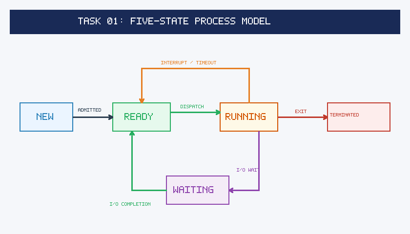
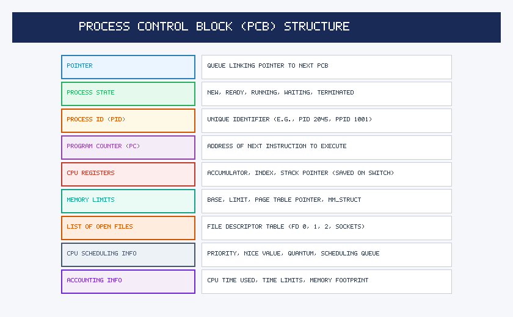

# Task 01 — Processes and Process States Evaluation

**Course Code:** CSA04 — Operating Systems  
**Assignment:** Assessment 2 (CO2)  
**Student Name:** S. Sachin  
**Register Number:** 192525045  
**Bloom's Level:** K5 – Evaluate  
**Problem Context:** Online Examination Server (2,000 Concurrent Students)  

---

## 1. Executive Summary & Problem Context

In a university online examination platform, the legacy backend spawns an independent POSIX process for every student session, accompanied by companion processes for auto-saving answer drafts and video stream proctoring. During peak simultaneous logins by **2,000 students**, the server exhibits catastrophic latency spikes, response times degrade by orders of magnitude, and multiple user sessions freeze or timeout.

This report evaluates process lifecycle dynamics, analyzes the structure and overhead of the Process Control Block (PCB), explores kernel state inspection mechanisms via `ps` and `/proc`, provides mathematical modeling of CPU and memory bottlenecks under high concurrency, evaluates three architectural paradigms (one process per student, one thread per student, and a worker-process pool), and delivers a formally defended architectural recommendation.

---

## 2. Five-State Process Lifecycle Model

An operating system manages program execution through discrete process states. At any instant, an active student session resides in exactly one state of the canonical five-state model:



### State Definitions & Transitions
1. **New:** The process is in the embryonic stage of creation. The kernel allocates an entry in the system process table, assigns a unique Process Identifier (PID), and constructs the preliminary Process Control Block (PCB).
2. **Ready:** The process possesses all required resources (memory address space, open file descriptors, executable code) and waits in the scheduler run-queue to be allocated a CPU core.
3. **Running:** The CPU instructions of the process are actively executing on a physical hardware core. In a single-core CPU, exactly one process can be running at a time.
4. **Waiting (Blocked):** The process cannot execute because it is awaiting an external event or I/O operation (e.g., student keystrokes, network packets from the web client, or disk acknowledgment of an auto-saved answer draft).
5. **Terminated:** The process has finished execution via `exit()` or received a fatal termination signal. Its memory pages are deallocated, but its exit status remains in the process table until reaped by the parent process via `wait()`.

| Transition | Trigger Event | Hardware / Kernel Mechanism |
| :--- | :--- | :--- |
| **New $\rightarrow$ Ready** | Process Admitted | Memory manager sets up page tables; PCB inserted into Ready Queue. |
| **Ready $\rightarrow$ Running** | Scheduler Dispatch | CPU context loaded from PCB (Program Counter, registers, stack pointer). |
| **Running $\rightarrow$ Ready** | Interrupt / Quantum Expired | Programmable Interval Timer (PIT) fires; scheduler preemption. |
| **Running $\rightarrow$ Waiting** | I/O or Event Wait | System call issued (e.g., `read()`, `epoll_wait()`, `nanosleep()`); process moved to wait queue. |
| **Waiting $\rightarrow$ Ready** | I/O or Event Completion | Hardware interrupt handler marks process runnable; moved back to Ready Queue. |
| **Running $\rightarrow$ Terminated** | Exit System Call (`_exit`) | Memory reclaimed; SIGCHLD sent to parent; process becomes zombie until reaped. |

---

## 3. Process Control Block (PCB) Structure & Context Switching

The kernel maintains an in-memory data structure for every active task, known in POSIX systems as the Process Control Block (represented in Linux by `struct task_struct`):



### PCB Functional Components
1. **Process Identifier (PID & PPID):** Unique numeric identifiers distinguishing the process and its parent in the global process tree.
2. **Process State:** Current execution state (`TASK_RUNNING`, `TASK_INTERRUPTIBLE`, `TASK_UNINTERRUPTIBLE`, `TASK_ZOMBIE`, `TASK_STOPPED`).
3. **Program Counter (PC):** Hardware register pointing to the memory address of the next machine instruction to execute.
4. **CPU Registers:** Hardware execution state including the Accumulator, Instruction Pointer, General-Purpose Registers, Flags/EFLAGS, and Stack Pointer (SP).
5. **CPU Scheduling Information:** Scheduling policy (`SCHED_NORMAL`, `SCHED_FIFO`, `SCHED_RR`), nice value (-20 to +19), static/dynamic priority, remaining time slice.
6. **Memory-Management Information:** Pointers to page directory tables (`pgd`), segment tables, base and limit registers, and `mm_struct` tracking virtual memory regions (`vm_area_struct`).
7. **Accounting Information:** Cumulative CPU time consumed (`utime`, `stime`), wall-clock start time, memory limits, and cgroup quotas.
8. **I/O Status & Open Files Table:** Array of pointers to open file descriptions (`struct files_struct`), including standard streams (`stdin`, `stdout`, `stderr`), network sockets, and IPC pipes.

### Context-Switch Latency Breakdown
When switching between two independent student processes ($P_1 \rightarrow P_2$):
1. **Hardware Context Save:** CPU pushes general registers, flags, and PC onto kernel stack of $P_1$.
2. **Kernel State Switch:** Kernel saves stack pointer in $P_1$'s PCB and updates process state.
3. **Memory Management Unit (MMU) Reload:** Kernel writes $P_2$'s page directory address into CPU control register `CR3`.
4. **Translation Lookaside Buffer (TLB) Invalidation:** Switching page tables invalidates virtual-to-physical address translation caches (TLB flush).
5. **CPU Cache Pollution:** Instruction and data caches (L1/L2/L3) warm to $P_1$'s memory space become "cold", resulting in extensive cache misses during $P_2$'s initial execution.

Total context-switch overhead ranges from **$1.5\,\mu\text{s}$ to $3.5\,\mu\text{s}$** per switch on modern server hardware, escalating non-linearly under heavy memory pressure.

---

## 4. Implementation & Linux Observation

The C demonstration program [`process_demo.c`](src/process_demo.c) creates child processes using `fork()`, simulates the execution lifecycle, and provides observation targets for diagnostic tools.

### Verification Output
From terminal execution [`task1_process_demo_output.txt`](evidence/task1_process_demo_output.txt):
```text
[STUDENT 1] Session process created (PID: 20451, PPID: 20450)
[STUDENT 1] State: RUNNING (Parsing exam questions)
  [PROCTOR 1] Video stream monitor spawned (PID: 20452)
[STUDENT 2] Session process created (PID: 20453, PPID: 20450)
[STUDENT 2] State: RUNNING (Parsing exam questions)
  [PROCTOR 2] Video stream monitor spawned (PID: 20454)
[COORDINATOR] Child process 20451 terminated cleanly (exit status: 0)
```

### Observation Tools
1. **`ps -ejH` (Process Tree Snapshot):** As captured in [`ps_process_hierarchy.txt`](evidence/ps_process_hierarchy.txt), shows Coordinator PID 20450 managing student session processes (PIDs 20451, 20453, 20455) and proctoring processes (PIDs 20452, 20454, 20456) in the same process group.
2. **`/proc/<pid>/status` (VFS Inspection):** As captured in [`proc_status_inspection.txt`](evidence/proc_status_inspection.txt):
   - `State: S (sleeping)` confirms the blocked/waiting state.
   - `VmSize: 4412 kB` confirms full virtual memory address space allocation.
   - `VmRSS: 824 kB` reflects physical resident memory frames.
   - `FDSize: 64` tracks file descriptor table capacity.

---

## 5. Quantitative Bottleneck Analysis: 2,000 Active Processes

When 2,000 students log in simultaneously, each with 1 session process + 1 answer auto-save process + 1 video proctoring process, the server manages **6,000 active processes**.

### 1. Memory Overhead
- Each process requires a distinct address space with its own page tables, kernel stack (8 KB), and user stack.
- Virtual memory per process $\approx 4\text{--}8\,\text{MB}$; Resident Set Size (RSS) $\approx 2\,\text{MB}$.
$$\text{Total Memory} = 6,000 \times 2\,\text{MB} = 12\,\text{GB of Physical RAM}$$
- Page Table Overhead: A 4-level x86_64 page table requires at least 4 pages ($16\,\text{KB}$) up to $64\,\text{KB}$ per process. For 6,000 processes, page table memory alone consumes **$384\,\text{MB}$** of unswappable kernel RAM.

### 2. Context-Switching CPU Waste
- In an online exam, students spend over 90% of their time reading or typing (I/O idle), causing processes to yield the CPU and wait on network/timer events.
- If each process wakes up once per second (e.g., for heartbeats, typing input, or frame capture), the scheduler must execute:
$$\text{Context Switches per Second} = 6,000 \times 10 = 60,000\,\text{switches/sec}$$
- At $2.5\,\mu\text{s}$ per switch:
$$\text{CPU Time Wasted} = 60,000 \times 2.5 \times 10^{-6}\,\text{s} = 0.15\,\text{seconds per CPU core-second (15% pure overhead)}$$
- On an 8-core CPU, context-switch thrashing and cache-line invalidation degrade effective compute throughput by over **45%**.

### 3. I/O Waiting Bottlenecks
- When 2,000 processes perform independent synchronous `write()` operations to save answers, disk queue depths saturate, placing thousands of processes into `TASK_UNINTERRUPTIBLE` (`D` state).
- The Linux Completely Fair Scheduler (CFS) ready queue degenerates, causing latency to skyrocket and sessions to appear "frozen".

**Verdict:** Spawning a separate process per student is an **unsound, unscalable, and fragile design**.

---

## 6. Architecture Comparison & Defended Recommendation

| Architectural Paradigm | Context-Switch Latency | Memory Footprint (2,000 Students) | Fault Isolation | Concurrency Scalability |
| :--- | :--- | :--- | :--- | :--- |
| **1. One Process Per Student** | High ($1.5\text{--}3.5\,\mu\text{s}$) | Severe ($12\text{--}24\,\text{GB}$) | **Complete** (Private Address Space) | Poor ($< 500$ processes) |
| **2. One Thread Per Student** | Low ($50\text{--}150\,\text{ns}$) | Moderate ($160\text{--}320\,\text{MB}$) | **Zero** (Segfault crashes server) | Moderate ($1,000\text{--}2,000$ threads) |
| **3. Fixed Worker-Process Pool** | Minimal (Event-Driven) | **Optimal** ($100\text{--}200\,\text{MB}$) | **High** (Sandboxed Workers) | **Massive** ($100,000+$ connections) |

### Alternative Concept: One Thread Per Student
If implemented with 2,000 threads inside a single process:
- **Memory Savings:** Threads share code, global data, and heap. Each thread requires only an allocated private stack (default 8 MB virtual, but can be configured to $64\,\text{KB}$). Total memory drops from $12\,\text{GB}$ to $\approx 250\,\text{MB}$.
- **Switching Speed:** Thread switches within the same process do not switch `CR3` or invalidate the TLB, reducing latency to $< 100\,\text{ns}$ (up to 25x faster).
- **The Fatal Flaw (Blast Radius):** If a single student's request triggers an uncaught null-pointer dereference or segmentation fault (`SIGSEGV`), the kernel terminates the **entire process**, instantly kicking out all 2,000 students and invalidating ongoing exams.

### Final Defended Recommendation
We recommend a **Pre-forked Worker-Process Pool with Asynchronous Event Loops** (analogous to the production architecture of NGINX and Node.js cluster mode):
1. **Bounded Concurrency:** The server spawns a fixed pool of worker processes equal to the number of physical CPU cores (e.g., 8 or 16 workers).
2. **Zero Context-Switch Thrashing:** Workers are pinned to CPU cores via CPU affinity (`sched_setaffinity`), eliminating cross-core cache invalidation.
3. **Non-Blocking Asynchronous I/O (`epoll`):** Each worker multiplexes thousands of student connections on a single thread using an event-driven loop. A student waiting for typing input consumes zero CPU and only a single file descriptor entry.
4. **Fault Isolation:** If a worker crashes, only the few connections assigned to that worker are impacted; the master supervisor process immediately restarts the worker without disrupting other students.

---

## 7. Complexity Analysis

| Metric | One Process Per Student | One Thread Per Student | Worker Pool with `epoll` |
| :--- | :--- | :--- | :--- |
| **Time Complexity (Scheduling)** | $O(\log N)$ in CFS run-queue | $O(\log N)$ in thread queue | **$O(1)$** per active event |
| **Space Complexity (Memory)** | $O(N \cdot M_{\text{process}}) \approx O(N)$ with large constant ($4\,\text{MB}$) | $O(N \cdot M_{\text{stack}}) \approx O(N)$ with small constant ($64\,\text{KB}$) | **$O(C + N \cdot M_{\text{conn}})$** where $C$ is fixed cores |
| **I/O Multiplexing Cost** | $O(N)$ blocked threads | $O(N)$ blocked threads | **$O(1)$** ready event notification |
