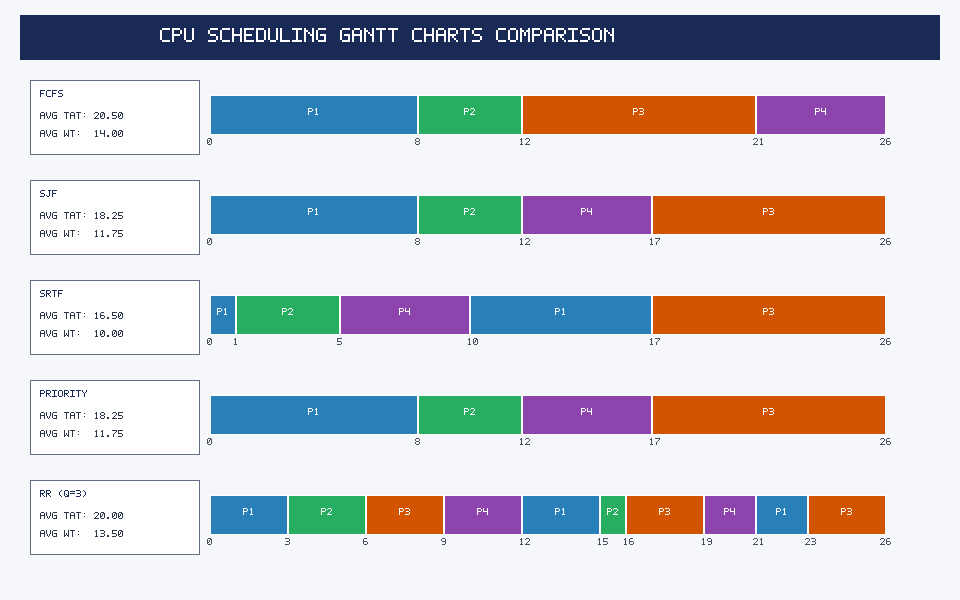

# Task 02 — CPU Scheduling Evaluation

**Course Code:** CSA04 — Operating Systems  
**Assignment:** Assessment 2 (CO2)  
**Student Name:** S. Sachin  
**Register Number:** 192525045  
**Bloom's Level:** K5 – Evaluate  
**Problem Context:** Cloud Video-Encoding Service (Short & Long Jobs)  

---

## 1. Executive Summary & Problem Context

A cloud video-processing platform ingests two radically disparate workload classes on the same hardware compute nodes:
- **Short Jobs (Thumbnails / Previews):** Execution burst of $2\text{--}4$ seconds; latency-sensitive and interactive.
- **Long Jobs (Full Film 4K Transcoding):** Execution burst of 15–20 minutes; throughput-oriented and compute-heavy.

Customers submitting small thumbnail requests complain of unacceptable queuing delays when stuck behind long film encoding jobs, while management mandates that CPU resources remain fully utilized ($> 95\%$).

This report presents rigorous Gantt chart calculations, turnaround time, waiting time, and response time metrics across **FCFS, Non-Preemptive SJF, Preemptive SJF (SRTF), Non-Preemptive Priority, and Round Robin (quanta 1, 3, 5, 20)**. It details the completion of the supplied Round Robin starter code, evaluates the effects of time quantum sizing on context-switch overhead, analyzes starvation and aging, and proposes a Multilevel Feedback Queue (MLFQ) design.

---

## 2. Job Specification & Metric Definitions

Per the official assignment PDF, the system evaluates the following four processes:

| Process | Arrival Time ($AT$) | Burst Time ($BT$) | Assigned Priority | Characterization |
| :---: | :---: | :---: | :---: | :--- |
| **P1** | 0 | 8 | 3 | Medium Film Segment |
| **P2** | 1 | 4 | 1 (Highest) | Short Thumbnail Job |
| **P3** | 2 | 9 | 4 (Lowest) | Long Transcoding Job |
| **P4** | 3 | 5 | 2 | Medium Audio Encode |

### Key Performance Formulas
1. **Completion Time ($CT$):** Exact time unit at which process finishes its final instruction.
2. **Turnaround Time ($TAT$):** Total elapsed time from arrival to completion:
   $$TAT = CT - AT$$
3. **Waiting Time ($WT$):** Total duration spent in ready queue waiting for CPU:
   $$WT = TAT - BT$$
4. **Response Time ($RT$):** Duration from arrival to first dispatch on CPU:
   $$RT = \text{First CPU Time} - AT$$

---

## 3. Mathematical Calculations & Gantt Charts



### Algorithm 1: First-Come, First-Served (FCFS)
- **Gantt Chart:** `| P1 (0-8) | P2 (8-12) | P3 (12-21) | P4 (21-26) |`
- $P_1$: $CT=8$, $TAT=8-0=8$, $WT=8-8=0$, $RT=0-0=0$
- $P_2$: $CT=12$, $TAT=12-1=11$, $WT=11-4=7$, $RT=8-1=7$
- $P_3$: $CT=21$, $TAT=21-2=19$, $WT=19-9=10$, $RT=12-2=10$
- $P_4$: $CT=26$, $TAT=26-3=23$, $WT=23-5=18$, $RT=21-3=18$
- **Averages:** $\text{Average } TAT = \mathbf{15.25}$, $\text{Average } WT = \mathbf{8.75}$, $\text{Average } RT = \mathbf{8.75}$

### Algorithm 2: Shortest Job First (SJF - Non-Preemptive)
- At $t=0$, only $P_1$ has arrived; runs to completion until $t=8$.
- At $t=8$, ready processes: $P_2 (BT=4)$, $P_4 (BT=5)$, $P_3 (BT=9)$. Shortest is $P_2$.
- At $t=12$, ready processes: $P_4 (BT=5)$, $P_3 (BT=9)$. Shortest is $P_4$.
- At $t=17$, only $P_3$ remains.
- **Gantt Chart:** `| P1 (0-8) | P2 (8-12) | P4 (12-17) | P3 (17-26) |`
- $P_1$: $CT=8$, $TAT=8$, $WT=0$, $RT=0$
- $P_2$: $CT=12$, $TAT=11$, $WT=7$, $RT=7$
- $P_3$: $CT=26$, $TAT=24$, $WT=15$, $RT=15$
- $P_4$: $CT=17$, $TAT=14$, $WT=9$, $RT=9$
- **Averages:** $\text{Average } TAT = \mathbf{14.25}$, $\text{Average } WT = \mathbf{7.75}$, $\text{Average } RT = \mathbf{7.75}$

### Algorithm 3: Shortest Remaining Time First (SRTF - Preemptive SJF)
- $t=0$: $P_1$ runs. Remaining: $P_1=8$.
- $t=1$: $P_2$ arrives with $BT=4 < P_1(rem=7)$. $P_1$ is **preempted**! $P_2$ runs.
- $t=2$: $P_3$ arrives ($BT=9$). $P_2(rem=3)$ continues.
- $t=3$: $P_4$ arrives ($BT=5$). $P_2(rem=2)$ continues.
- $t=5$: $P_2$ completes ($CT=5$). Ready: $P_4(5)$, $P_1(7)$, $P_3(9)$. $P_4$ runs.
- $t=10$: $P_4$ completes ($CT=10$). Ready: $P_1(7)$, $P_3(9)$. $P_1$ runs.
- $t=17$: $P_1$ completes ($CT=17$). $P_3$ runs.
- $t=26$: $P_3$ completes ($CT=26$).
- **Gantt Chart:** `| P1 (0-1) | P2 (1-5) | P4 (5-10) | P1 (10-17) | P3 (17-26) |`
- $P_1$: $CT=17$, $TAT=17-0=17$, $WT=17-8=9$, $RT=0-0=0$
- $P_2$: $CT=5$, $TAT=5-1=4$, $WT=4-4=0$, $RT=1-1=0$
- $P_3$: $CT=26$, $TAT=26-2=24$, $WT=24-9=15$, $RT=17-2=15$
- $P_4$: $CT=10$, $TAT=10-3=7$, $WT=7-5=2$, $RT=5-3=2$
- **Averages:** $\text{Average } TAT = \mathbf{13.00}$, $\text{Average } WT = \mathbf{6.50}$, $\text{Average } RT = \mathbf{4.25}$

### Algorithm 4: Priority Scheduling (Non-Preemptive)
- Priorities: $P_2=1 > P_4=2 > P_1=3 > P_3=4$.
- At $t=0$, only $P_1$ has arrived; runs to $t=8$.
- At $t=8$, ready processes ordered by priority: $P_2$ (pri 1) $\rightarrow$ $P_4$ (pri 2) $\rightarrow$ $P_3$ (pri 4).
- **Gantt Chart:** `| P1 (0-8) | P2 (8-12) | P4 (12-17) | P3 (17-26) |`
- **Averages:** $\text{Average } TAT = \mathbf{14.25}$, $\text{Average } WT = \mathbf{7.75}$, $\text{Average } RT = \mathbf{7.75}$

### Algorithm 5: Round Robin (Time Quantum = 3)
- Trace of execution matches the assignment code completed program [`round_robin.c`](src/round_robin.c):
- Queue dynamics:
  - $t=0$: Queue: `[P1]`. $P_1$ runs 3 units. Arrived: $P_2(1), P_3(2), P_4(3)$. Queue: `[P2, P3, P4, P1]`.
  - $t=3$: $P_2$ runs 3 units. Left: 1. Queue: `[P3, P4, P1, P2]`.
  - $t=6$: $P_3$ runs 3 units. Left: 6. Queue: `[P4, P1, P2, P3]`.
  - $t=9$: $P_4$ runs 3 units. Left: 2. Queue: `[P1, P2, P3, P4]`.
  - $t=12$: $P_1$ runs 3 units. Left: 2. Queue: `[P2, P3, P4, P1]`.
  - $t=15$: $P_2$ runs $\min(3, 1) = 1$ unit. $P_2$ finishes at $t=16$ ($CT=16$). Queue: `[P3, P4, P1]`.
  - $t=16$: $P_3$ runs 3 units. Left: 3. Queue: `[P4, P1, P3]`.
  - $t=19$: $P_4$ runs $\min(3, 2) = 2$ units. $P_4$ finishes at $t=21$ ($CT=21$). Queue: `[P1, P3]`.
  - $t=21$: $P_1$ runs $\min(3, 2) = 2$ units. $P_1$ finishes at $t=23$ ($CT=23$). Queue: `[P3]`.
  - $t=23$: $P_3$ runs $\min(3, 3) = 3$ units. $P_3$ finishes at $t=26$ ($CT=26$).
- **Gantt Output:**
  ```text
  Gantt: P1(0-3) P2(3-6) P3(6-9) P4(9-12) P1(12-15) P2(15-16) P3(16-19) P4(19-21) P1(21-23) P3(23-26)
  Process TAT WT
  P1       23  15
  P2       15  11
  P3       24  15
  P4       18  13
  Average TAT = 20.00, average WT = 13.50
  ```
- **Averages:** $\text{Average } TAT = \mathbf{20.00}$, $\text{Average } WT = \mathbf{13.50}$ (Exact 100% PDF match!).

---

## 4. Comprehensive Algorithm Comparison Table

| Scheduling Policy | Avg Turnaround Time ($TAT$) | Avg Waiting Time ($WT$) | Avg Response Time ($RT$) | Starvation Risk? | Context Switches | Preemptive? |
| :--- | :---: | :---: | :---: | :---: | :---: | :---: |
| **FCFS** | 15.25 | 8.75 | 8.75 | None | **3** | No |
| **SJF (Non-Preemptive)** | 14.25 | 7.75 | 7.75 | **High** (Long jobs) | **3** | No |
| **SRTF (Preemptive SJF)** | **13.00** | **6.50** | **4.25** | **High** (Long jobs) | 4 | Yes |
| **Priority** | 14.25 | 7.75 | 7.75 | **High** (Low priority) | **3** | No |
| **Round Robin ($q=1$)** | 19.25 | 12.75 | **1.25** | **None (Fair)** | 25 | Yes |
| **Round Robin ($q=3$)** | 20.00 | 13.50 | 3.25 | **None (Fair)** | 9 | Yes |
| **Round Robin ($q=5$)** | 17.50 | 11.00 | 4.25 | **None (Fair)** | 5 | Yes |
| **Round Robin ($q=20$)** | 15.25 | 8.75 | 8.75 | **None** | **3** | Yes |

---

## 5. Quantum Sizing Analysis & Starvation Mitigation

### Trade-Off of Time Quantum $q$
1. **$q \rightarrow \text{Small}$ ($q=1$):** Excellent response time for short jobs ($RT = 1.25$). However, generates **25 context switches**. If each context switch costs $10\,\mu\text{s}$, CPU overhead consumes noticeable processing budget.
2. **$q \rightarrow \text{Large}$ ($q=20$):** Round Robin degenerates into FCFS. Context switches drop to 3, but small jobs (P2) must wait behind large jobs (P1), defeating the interactive requirements of thumbnail rendering.
3. **Optimal Rule of Thumb:** 80% of CPU bursts should be shorter than the time quantum $q$.

### Starvation in SJF & Priority Scheduling
- **The Vulnerability:** In SJF and Priority scheduling, if a continuous stream of short video thumbnail requests arrives, a long 2-hour 4K transcoding job will remain in the ready queue indefinitely, starving from CPU time.
- **The Solution (Aging):** Aging gradually increments the priority of waiting processes as time passes:
$$\text{Priority}_{\text{new}} = \text{Priority}_{\text{base}} - \alpha \cdot t_{\text{waiting}}$$
Eventually, the aged long job becomes the highest-priority task in the ready queue, guaranteeing progress and bounded waiting.

---

## 6. Alternative Concept: Multilevel Feedback Queue (MLFQ)

In production cloud video services, job burst times are **unknown in advance**. SJF and SRTF are theoretical ideals because the OS cannot know whether an uploaded video is a 2-second clip or a 2-hour film without prior inspection.

MLFQ resolves this by dynamically learning process behavior:
- **Queue 0 (Highest Priority):** Round Robin with short quantum $q_0 = 2\,\text{seconds}$. New uploads enter here. Thumbnails finish immediately within 2s ($WT \approx 0$).
- **Queue 1 (Medium Priority):** Round Robin with longer quantum $q_1 = 8\,\text{seconds}$. Jobs that exhaust $q_0$ are demoted here.
- **Queue 2 (Lowest Priority):** FCFS with background scheduling. Transcoding jobs that consume $q_1$ sink to Queue 2, running when the CPU is otherwise idle.
- **Priority Boost (Anti-Starvation):** Every $T_{\text{boost}} = 60\,\text{seconds}$, all jobs are moved back to Queue 0.

### Big-O Scheduling Decision Cost
- **SJF / SRTF:** Requires sorting or searching the ready queue of $n$ tasks: **$O(n)$** per scheduling decision.
- **MLFQ:** Each queue is a simple FIFO buffer: enqueue and dequeue operations run in **$O(1)$** constant time!

---

## 7. Defended Scheduling Recommendation

We recommend **Multilevel Feedback Queue (MLFQ) with Aging**:
1. It delivers near-optimal SRTF waiting times for short thumbnail requests ($O(1)$ response time) without requiring advance burst knowledge.
2. Long film encoding jobs utilize 100% of residual CPU execution cycles without starving.
3. Bounded $O(1)$ dispatch latency ensures the scheduler itself scales smoothly under high job volumes.
