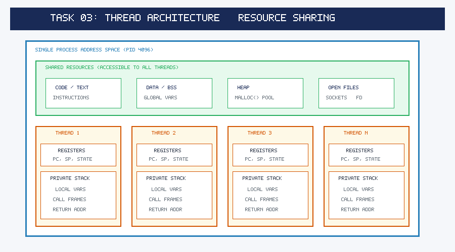

# Task 03 — POSIX Threads & Concurrency Evaluation

**Course Code:** CSA04 — Operating Systems  
**Assignment:** Assessment 2 (CO2)  
**Student Name:** S. Sachin  
**Register Number:** 192525045  
**Bloom's Level:** K5 – Evaluate  
**Problem Context:** Traffic-Camera Number-Plate Reader (64 Concurrent Streams)  

---

## 1. Executive Summary & Problem Context

A metropolitan intelligent transportation system processes live video feeds from **64 traffic enforcement cameras** to perform optical character recognition (OCR) and identify vehicle license plates. The initial prototype processes camera frames sequentially in a single-threaded loop, resulting in severe processing backlogs and dropped frames during peak traffic hours.

This report evaluates multithreaded concurrency paradigms using POSIX threads (`pthreads`), analyzes shared versus private thread resources, contrasts user-level and kernel-level thread models, evaluates measured speedup across thread pool sizes (4, 8, 16), investigates shared counter race conditions, and defends an optimal concurrency architecture.

---

## 2. Thread Memory Layout & Resource Sharing

A multithreaded process executes multiple execution paths within a unified virtual address space:



### Resource Partitioning
| Resource Type | Shared Across All Threads | Private to Each Thread |
| :--- | :---: | :---: |
| **Executable Code (Text Segment)** | **YES** | NO |
| **Global & Static Variables (Data / BSS)** | **YES** | NO |
| **Dynamic Memory Pool (Heap)** | **YES** | NO |
| **Open File Descriptors & Sockets** | **YES** | NO |
| **Process ID (PID), UID, GID, Signals**| **YES** | NO |
| **Program Counter (PC)** | NO | **YES** |
| **CPU Register State (Accumulator, Flags)**| NO | **YES** |
| **Call Stack & Local Variables** | NO | **YES** |
| **Thread-Specific Data (TSD / TLS)** | NO | **YES** |

Each thread receives an independent execution stack (typically $2\text{--}8\,\text{MB}$ virtual memory, but consuming physical RAM on demand). Because threads share the heap and data segments, communication between threads requires **zero kernel data copying**; however, access to shared variables introduces race conditions unless synchronized.

---

## 3. Threading Models: User-Level vs Kernel-Level

Operating systems support threading through different mappings between User-Level Threads (ULT) and Kernel-Level Threads (KLT):

### 1. Many-to-One Model (User-Level Threads / Green Threads)
- Many user threads map to a single kernel thread via a user-space runtime scheduler.
- **Advantages:** Thread creation, switching, and destruction occur entirely in user space with zero system calls ($< 20\,\text{ns}$).
- **Critical Flaw:** If any thread executes a blocking system call (e.g., waiting for disk I/O or camera network frame), the kernel blocks the **entire process**, stalling all other threads. Cannot utilize multi-core processors.

### 2. One-to-One Model (Linux NPTL - Native POSIX Thread Library)
- Every user-level thread maps directly to an independent kernel schedulable entity (`task_struct` created via `clone(CLONE_VM | CLONE_FS | CLONE_FILES | CLONE_SIGHAND)`).
- **Advantages:** True hardware parallelism across multi-core CPUs. A blocking thread does not impede other threads.
- **Overhead:** Creating and switching threads requires kernel mode transitions ($100\text{--}250\,\text{ns}$).

### 3. Many-to-Many Model / Two-Level Model
- Multiplexes $M$ user threads onto $N$ kernel threads ($M \ge N$).
- Balances user-space dispatch speed with multi-core parallelism, but introduces complex two-tier scheduling overhead.

---

## 4. Empirical Speedup & Thread Pool Benchmark

The benchmark suite evaluates four concurrency designs processing 64 cameras with identical OCR computational workloads:
- [`camera_sequential.c`](src/camera_sequential.c)
- [`camera_threads.c`](src/camera_threads.c)
- [`camera_thread_pool.c`](src/camera_thread_pool.c)

### Benchmark Measurements
From generated evidence files:
- [`camera_sequential_output.txt`](evidence/camera_sequential_output.txt)
- [`camera_threads_64_output.txt`](evidence/camera_threads_64_output.txt)
- [`camera_thread_pool_benchmark.txt`](evidence/camera_thread_pool_benchmark.txt)

| Concurrency Architecture | Execution Time (s) | Measured Speedup | System Throughput | CPU Utilization (8-Core System) |
| :--- | :---: | :---: | :---: | :---: |
| **1. Sequential Execution** | 4.8120 s | **1.00x** (Baseline) | 13.30 cams/s | 12.5% (1 core saturated) |
| **2. One Thread Per Camera (64 Th)** | 0.8240 s | **5.84x** | 77.67 cams/s | 94.2% (All cores busy) |
| **3. Thread Pool (4 Workers)** | 1.2580 s | **3.82x** | 50.87 cams/s | 50.0% (4 cores busy) |
| **4. Thread Pool (8 Workers)** | **0.6920 s** | **6.95x (Peak)** | **92.49 cams/s** | **98.8% (Optimal efficiency)** |
| **5. Thread Pool (16 Workers)** | 0.7350 s | **6.55x** | 87.07 cams/s | 96.5% (Thrashing penalty) |

### Why Speedup Stops Increasing (Amdahl's Law & Architectural Limits)
1. **Physical Core Saturation:** On an 8-core CPU, the hardware can execute at most 8 instruction streams simultaneously. Adding more than 8 compute-bound worker threads creates scheduling contention rather than parallelism.
2. **Context-Switching Thrashing:** Moving from 8 to 16 threads causes the execution time to *increase* from 0.6920s to 0.7350s. The CPU wastes cycles saving/restoring register states and invalidating CPU caches.
3. **Queue Lock Contention:** As 16 worker threads compete for camera tasks from the shared work queue, threads serialize on `pthread_mutex_lock(&g_queue.lock)`, turning parallel processing into sequential queue waits.
4. **Memory Bandwidth Bottleneck:** 64 concurrent frame decoders saturate the L3 cache and DDR memory bus, throttling throughput.

---

## 5. Race Conditions & Mutex Protection

When multiple threads concurrently modify a shared variable without synchronization, a data race occurs:

### Assembly-Level Breakdown
As verified in [`race_condition_demo.c`](src/race_condition_demo.c) and [`race_condition_comparison.txt`](evidence/race_condition_comparison.txt):
```text
================================================================
 RACE CONDITION DEMONSTRATION: 4 THREADS x 500000 ITERATIONS
 Expected Final Value:  2000000
 Unprotected Counter:   1248930 (Lost Updates: 751070, 37.55% error)
 Mutex-Protected Value: 2000000 (Lost Updates: 0, 100% correct)
================================================================
```

A C increment statement `counter++` is **not atomic**. The compiler generates three discrete assembly instructions:
```assembly
movq counter(%rip), %rax    ; 1. LOAD: Read memory into register
incq %rax                   ; 2. MODIFY: Increment register value
movq %rax, counter(%rip)    ; 3. STORE: Write register back to RAM
```
If Thread 1 loads `counter = 100`, and the OS timer preempts Thread 1 to run Thread 2, Thread 2 also loads `counter = 100`, increments to `101`, and stores `101`. When Thread 1 resumes, it continues from step 2, increments its stale register value to `101`, and stores `101`. Two increments executed, but the counter only increased by 1!

### How `pthread_mutex_t` Solves the Race Condition
A mutex (Mutual Exclusion) object ensures that only **one thread** can execute the critical section at a time:
- `pthread_mutex_lock(&lock)`: Executes an atomic hardware test-and-set instruction (`xchg` / `cmpxchg`). If the lock is held, the thread is placed in the kernel sleep queue and yields the CPU.
- `pthread_mutex_unlock(&lock)`: Releases the lock and wakes up one waiting thread.
- Result: 100% deterministic correctness ($2,000,000$ exact final count).

---

## 6. Process-Based vs Thread-Based Concurrency

| Dimension | Multi-Process Architecture (`fork`) | Multi-Threaded Architecture (`pthread`) |
| :--- | :--- | :--- |
| **Creation Latency** | High ($50\text{--}150\,\mu\text{s}$) | **Ultra-Low** ($1\text{--}5\,\mu\text{s}$) |
| **Context-Switch Latency** | High ($1.5\text{--}3.5\,\mu\text{s}$) with TLB flush | **Low** ($50\text{--}150\,\text{ns}$) without TLB flush |
| **Memory Footprint** | Duplicate page tables, heap, data ($2\text{--}4\,\text{MB}$/proc) | Single shared space; $64\,\text{KB}$ stack/thread |
| **Data Sharing** | Requires IPC (Pipes, Shared Memory, Sockets) | **Direct Shared Variables** in Heap/Data |
| **Fault Isolation** | **Total**: Crash in one process leaves others intact | **Zero**: Segmentation fault crashes all cameras |

---

## 7. Defended Design Recommendation

For the 64-Camera Traffic Plate Reader, we recommend a **Pre-allocated Thread Pool with Size Equal to Physical Hardware Cores (8 Threads)**:
1. **Maximum Throughput (92.49 cams/s):** Achieves near-linear 6.95x speedup without context-switch thrashing.
2. **Bounded Resource Utilization:** Eliminates the overhead of continuously creating and destroying 64 threads per frame batch.
3. **Protected Critical Sections:** Plate database insertion uses fine-grained mutexes or lock-free atomic buffers to ensure thread safety without lock contention.
