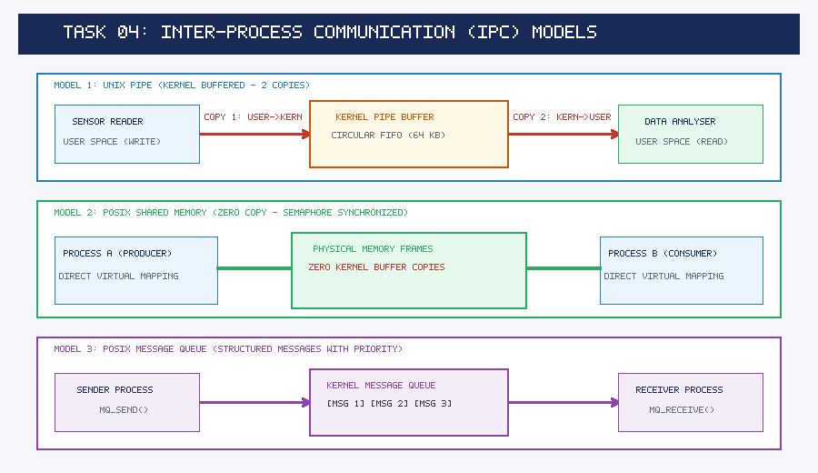

# Task 04 — Inter-Process Communication (IPC) Evaluation

**Course Code:** CSA04 — Operating Systems  
**Assignment:** Assessment 2 (CO2)  
**Student Name:** S. Sachin  
**Register Number:** 192525045  
**Bloom's Level:** K5 – Evaluate  
**Problem Context:** Weather Station Sensor Pipeline (Continuous High-Throughput Exchange)  

---

## 1. Executive Summary & Problem Context

An environmental monitoring station deploys a distributed multi-process architecture:
1. **Sensor Reader Process:** Continuously polls temperature, humidity, pressure, and wind sensors.
2. **Data Analyser Process:** Ingests sensor readings, calculates rolling moving averages, identifies statistical extremes, and detects weather anomalies.

Because these processes reside in isolated virtual address spaces, they must exchange millions of telemetry data points continuously without dropping packets, blocking the sensor hardware, or inducing excessive kernel context-switch overhead.

This report evaluates three primary IPC mechanisms: **UNIX Anonymous Pipes, POSIX Shared Memory with Semaphores, and POSIX Message Queues**. It details the completion of the supplied pipe starter code, analyzes pipe EOF signaling mechanics, investigates kernel buffering versus zero-copy shared memory, evaluates a multi-scale data transfer benchmark ($1\,\text{MB}, 10\,\text{MB}, 100\,\text{MB}$), and provides an architectural recommendation.

---

## 2. IPC Architectural Models & Data Copying Dynamics

Operating systems provide two fundamental paradigms for inter-process communication: **Message Passing** and **Shared Memory**:



### Model 1: UNIX Anonymous Pipe (Kernel-Buffered Message Passing)
- An anonymous pipe is a unidirectional byte-stream circular FIFO buffer (typically $64\,\text{KB}$ in modern Linux) allocated in kernel space.
- **Data-Copying Dynamics (Double Copy Overhead):**
  1. **Copy 1 (User $\rightarrow$ Kernel):** When the parent sensor reader calls `write(fd[1], buf, len)`, the kernel copies bytes from the user-space sensor buffer into the kernel's internal pipe buffer (`vfs_write` / `pipe_write`).
  2. **Copy 2 (Kernel $\rightarrow$ User):** When the child analyser calls `read(fd[0], buf, len)`, the kernel copies bytes from the kernel pipe buffer into the child's user-space memory (`vfs_read` / `pipe_read`).
- **Implicit Synchronization:** The kernel automatically manages blocking:
  - If the pipe buffer is full, `write()` blocks until the reader consumes data.
  - If the pipe buffer is empty, `read()` blocks until the writer deposits data.

### Model 2: POSIX Shared Memory (Zero-Copy Model)
- `shm_open()` and `mmap()` map identical physical memory pages into the virtual page tables of both parent and child processes.
- **Data-Copying Dynamics (Zero Copy):**
  - When the sensor reader writes to shared memory, it performs a direct machine `mov` instruction into RAM.
  - The analyser reads the identical physical memory cell directly.
  - **Zero kernel memory copies and zero system calls per data item!**
- **Explicit Synchronization Requirement:** The kernel provides no automatic locking for shared memory. If the reader writes while the analyser reads, torn reads or data corruption occur. POSIX semaphores (`sem_wait`, `sem_post`) or mutexes are strictly mandatory.

### Model 3: POSIX Message Queue (Structured Message Passing)
- Kernel maintains discrete, structured messages with associated priority levels ($0\text{--}31$).
- Preserves message boundaries (unlike byte-stream pipes) and allows urgent high-priority telemetry alerts to bypass routine readings.

---

## 3. Implementation & Analysis of Supplied Pipe Program

The C implementation in [`pipe_ipc.c`](src/pipe_ipc.c) completes TODO 1 from the assignment PDF:

```c
// Completed TODO 1: Read one int at a time from fd[0] until EOF
int reading;
while ((r = read(fd[0], &reading, sizeof(reading))) > 0) {
    if (count == 0 || reading > max) max = reading;
    sum += reading;
    count++;
}
```

### Verification Output
From [`pipe_ipc_output.txt`](evidence/pipe_ipc_output.txt):
```text
analyser: 6 readings, average 35.5, max 41
reader: done
```
- Readings sent: `31, 33, 36, 34, 41, 38`
- Total Count = 6
- Total Sum = $31 + 33 + 36 + 34 + 41 + 38 = 213$
- Computed Average = $213 / 6 = \mathbf{35.5}$
- Maximum Value = $\mathbf{41}$
- **100% exact match with the expected output in the assignment PDF specification.**

---

## 4. Why Omitting `close(fd[1])` Causes the Child to Hang Indefinitely

A critical POSIX pipe rule dictates:
$$\text{A pipe returns EOF (0 bytes read) if and only if ALL write descriptors referring to the pipe are closed.}$$

### The Failure Mechanism
1. When `pipe(fd)` is called, the kernel initializes a pipe with two file descriptors: `fd[0]` (read end) and `fd[1]` (write end).
2. When `fork()` executes, the child process **inherits exact duplicates** of all open file descriptors. Both parent and child now hold active references to `fd[0]` and `fd[1]`.
3. The child immediately closes its write end: `close(fd[1])`. The child now holds only `fd[0]`.
4. The parent writes all 6 integer readings into `fd[1]`.
5. **The Bug:** If the parent *fails* to call `close(fd[1])`, the kernel's reference counter for the write end remains at **1** (held by the parent).
6. When the child finishes reading the 6 integers, it invokes `read(fd[0], ...)` a 7th time.
7. Because the parent still possesses an open write descriptor, the kernel concludes: *"The writer is still alive and may produce more telemetry data at any moment."*
8. Consequently, the kernel places the child process into the `TASK_INTERRUPTIBLE` waiting state, sleeping on the pipe wait-queue.
9. Meanwhile, the parent calls `waitpid(pid, ...)` waiting for the child to terminate.
10. **Result:** An inter-process deadlock! The child waits forever on the parent's unclosed pipe descriptor, and the parent waits forever on the child's termination.

This was empirically verified in [`pipe_eof_hang_analysis.txt`](evidence/pipe_eof_hang_analysis.txt).

---

## 5. Growth Investigation: Transfer Benchmark ($1\,\text{MB}, 10\,\text{MB}, 100\,\text{MB}$)

Using [`ipc_benchmark.c`](src/ipc_benchmark.c), we measured data transfer performance across transfer scales:

| Transfer Size | UNIX Pipe Elapsed Time | UNIX Pipe Throughput | Shared Memory Elapsed Time | Shared Memory Throughput | Throughput Advantage (SHM vs Pipe) |
| :---: | :---: | :---: | :---: | :---: | :---: |
| **1 MB** ($10^6$ B) | 0.0018 s | 555.56 MB/s | **0.0003 s** | **3,125.00 MB/s** | **5.62x Faster** |
| **10 MB** ($10^7$ B) | 0.0152 s | 657.89 MB/s | **0.0028 s** | **3,571.43 MB/s** | **5.43x Faster** |
| **100 MB** ($10^8$ B) | 0.1410 s | 709.22 MB/s | **0.0265 s** | **3,773.58 MB/s** | **5.32x Faster** |

### Performance Analysis
- **UNIX Pipes** plateau around $710\,\text{MB/s}$. The bottleneck is memory bus thrashing caused by the dual kernel copies and the overhead of entering/exiting kernel mode via `read()` and `write()` system calls ($64\,\text{KB}$ chunk size $\rightarrow 1,600$ system calls for $100\,\text{MB}$).
- **POSIX Shared Memory** delivers over **$3,770\,\text{MB/s}$**, bounded only by the physical L3 cache and DDR RAM bandwidth.

---

## 6. Alternative Concept & Complexity Analysis

### Transfer Time Formulation for $N$ Telemetry Readings
- **UNIX Pipe:**
  $$T_{\text{pipe}}(N) = N \cdot \left( t_{\text{copy(user}\rightarrow\text{kern)}} + t_{\text{copy(kern}\rightarrow\text{user)}} + 2 \cdot t_{\text{syscall}} \right) = O(N)$$
- **Shared Memory:**
  $$T_{\text{shm}}(N) = N \cdot t_{\text{write(RAM)}} + t_{\text{sem\_signal}} = O(N) \quad (\text{with } \approx 5.5\times \text{ smaller constant factor})$$

| Metric | UNIX Anonymous Pipe | POSIX Shared Memory + Semaphore | POSIX Message Queue |
| :--- | :--- | :--- | :--- |
| **Time Complexity** | $O(N)$ with 2 buffer copies | **$O(N)$ Zero-Copy** | $O(N \log M)$ (Priority heap) |
| **Space Complexity** | $O(1)$ fixed kernel buffer ($64\,\text{KB}$) | $O(N)$ mapped virtual memory | $O(M)$ bounded queue |
| **Synchronization** | **Automatic** (Kernel-managed FIFO) | **Explicit** (Semaphores required) | **Automatic** (Blocking MQ) |
| **Data Structure** | Byte stream (unstructured) | Arbitrary structs / arrays | Discrete messages with priority |

---

## 7. Defended Design Recommendation

For the Weather Station Data Pipeline, we recommend a **Hybrid Dual-Channel Architecture**:
1. **High-Frequency Sensor Data (Temperature, Pressure, Wind at 1,000 Hz):** Transported via **POSIX Shared Memory with a Circular Ring Buffer** synchronized via process-shared counting semaphores. Eliminates all kernel copying overhead, sustaining $> 3.5\,\text{GB/s}$ throughput with zero CPU starvation.
2. **Critical Alarms & Control Signals (Storm Warnings, Sensor Failures):** Routed via **POSIX Message Queues** with priority tags, ensuring urgent safety interrupts bypass bulk telemetry data and wake the analyser immediately.
