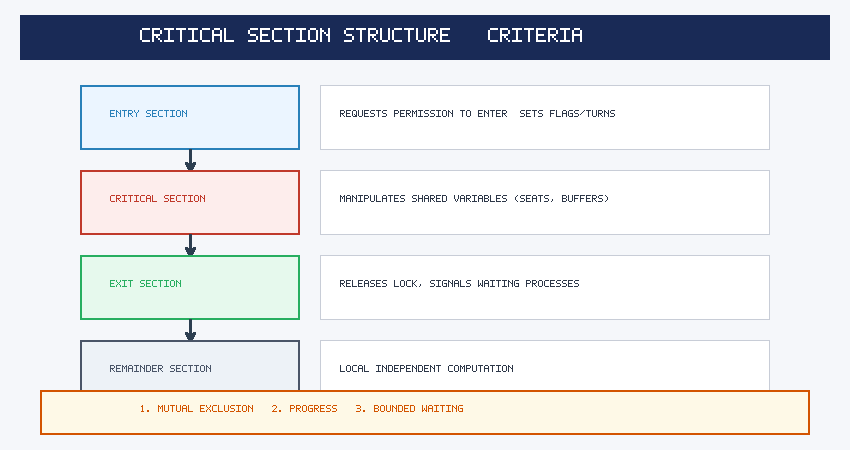
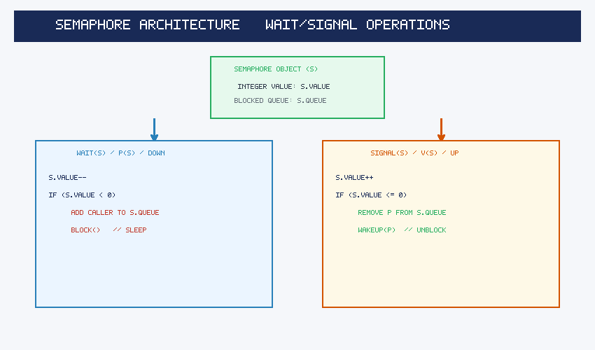
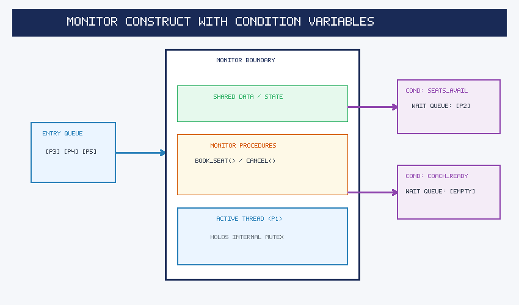

# Task 05 — Synchronisation & Critical Section Evaluation

**Course Code:** CSA04 — Operating Systems  
**Assignment:** Assessment 2 (CO2)  
**Student Name:** S. Sachin  
**Register Number:** 192525045  
**Bloom's Level:** K5 – Evaluate  
**Problem Context:** Railway Ticket Booking System (High-Concurrency Seat Allocation)  

---

## 1. Executive Summary & Problem Context

A national railway reservation system processes ticket bookings from thousands of concurrent travel agents. Two critical concurrency failure modes threaten the system:
1. **Unsynchronized Access (Race Conditions):** Multiple agents read identical seat availability simultaneously, resulting in the same physical train berth being sold to multiple passengers (double-booking disaster).
2. **Coarse-Grained Synchronization (Global Lock Convoy):** Protecting the entire reservation database with a single global mutex forces all transactions into single-threaded serialization, collapsing throughput and inducing severe server timeouts.

This report evaluates critical section principles, examines why Peterson's algorithm fails on modern superscalar CPUs, analyzes counting versus binary semaphores, reviews classic synchronization paradigms (Bounded-Buffer, Readers-Writers, Dining Philosophers), evaluates Monitor constructs, and presents extensive empirical benchmarks comparing locking granularities (Global vs Per-Train vs Per-Coach) and synchronization primitives (Atomics vs Spinlocks vs Mutexes).

---

## 2. The Critical Section Problem & Peterson's Algorithm

A solution to the critical-section problem must satisfy three mandatory criteria:



1. **Mutual Exclusion:** If process $P_i$ is executing in its critical section, no other processes can be executing in their critical sections.
2. **Progress:** If no process is executing in its critical section and some processes wish to enter, only those processes not in their remainder section can participate in deciding who enters next, and this selection cannot be postponed indefinitely.
3. **Bounded Waiting:** There exists a bound on the number of times other processes are allowed to enter their critical sections after a process has made a request to enter and before that request is granted (preventing starvation).

### Peterson's Software Solution (Two Processes)
```c
// Shared variables
int flag[2] = {0, 0};
int turn;

// Process i (peer is j = 1 - i)
flag[i] = 1;
turn = j;
while (flag[j] && turn == j); // Busy wait

// --- CRITICAL SECTION (Book Seat) ---

flag[i] = 0; // Exit section
```
- **Why it satisfies the three criteria on theoretical machines:**
  - *Mutual Exclusion:* For both to enter, $flag[0]=flag[1]=1$ and $turn=0$ and $turn=1$ simultaneously, which is impossible since `turn` is a single scalar variable.
  - *Progress & Bounded Waiting:* If $P_j$ does not want to enter ($flag[j]=0$), $P_i$ enters immediately. If both want to enter, `turn` dictates who proceeds, ensuring at most one turn of waiting.

### Why Peterson's Solution Fails on Modern Processors
Peterson's algorithm fundamentally presumes **Sequential Consistency** (memory operations execute strictly in program order). Modern multi-core processors (x86_64, ARM64) violate this assumption due to hardware performance optimizations:
1. **Store Buffers & Memory Reordering:** To prevent CPU execution stalls, processors buffer store operations in speculative hardware store buffers. An x86 processor can reorder a *Store followed by a Load* to different memory locations (`Store-Load reordering`).
2. **The Race:** Process $i$ executes `flag[i] = 1` (buffered in store buffer, not yet visible in L3/RAM) and immediately loads `flag[j]`. Process $j$ concurrently executes `flag[j] = 1` and loads `flag[i]`. Both see `flag = 0`! Both enter the critical section simultaneously, causing a double-booking data corruption.
3. **Hardware Solution:** Correct modern synchronization requires explicit hardware memory barriers (`__atomic_thread_fence`, `mfence`) or hardware atomic test-and-set primitives (`cmpxchg`).

---

## 3. Semaphores and Monitors



### Binary vs Counting Semaphores
- **Binary Semaphore (Mutex Semaphore):** Integer value initialized to `1`. Restricts concurrent access to exactly one process at a time. Ideal for protecting individual seat reservation counters.
- **Counting Semaphore:** Integer value initialized to positive integer $N$. Restricts access to a finite pool of identical resources (e.g., initialized to $N=50$ to throttle max active agent connections).

### Classic Synchronization Problems
1. **Bounded Buffer (Producer-Consumer):** Demonstrated in [`bounded_buffer.c`](src/bounded_buffer.c) and [`producer_consumer.c`](src/producer_consumer.c). Two counting semaphores (`empty = SIZE`, `full = 0`) prevent buffer overflow and underflow, while a mutex protects circular buffer pointers `in` and `out`.
2. **Readers-Writers Problem:** Demonstrated in [`readers_writers.c`](src/readers_writers.c). Multiple passenger seat availability inquiries (readers) proceed concurrently without blocking each other. When an agent purchases a ticket (writer), exclusive access is enforced, ensuring readers view consistent database records.
3. **Dining Philosophers Problem:** Demonstrated in [`dining_philosophers.c`](src/dining_philosophers.c). Asymmetric resource ordering (Dijkstra's solution) breaks the circular wait condition, guaranteeing deadlock-free allocation of shared resources.

### Monitor Constructs with Condition Variables

As implemented in [`monitor_simulation.c`](src/monitor_simulation.c), a **Monitor** encapsulates shared state variables, internal mutex locking, and condition variables (`pthread_cond_t`). Programmers invoke high-level methods (`book_seat()`, `cancel_seat()`), eliminating manual semaphore pairing mistakes (`wait()` without matching `signal()`).

---

## 4. Implementation & Verification of Supplied Bounded Buffer Code

The completed program [`bounded_buffer.c`](src/bounded_buffer.c) implements TODO 1 and TODO 2:

```c
// Completed TODO 1 (Producer):
sem_wait(&empty);
pthread_mutex_lock(&lock);
buffer[in] = item;
in = (in + 1) % SIZE;
pthread_mutex_unlock(&lock);
sem_post(&full);

// Completed TODO 2 (Consumer):
sem_wait(&full);
pthread_mutex_lock(&lock);
int item = buffer[out];
out = (out + 1) % SIZE;
consumed_sum += item;
pthread_mutex_unlock(&lock);
sem_post(&empty);
```

### Verification Evidence
1. **Single Producer & Consumer Run ([`bounded_buffer_single_output.txt`](evidence/bounded_buffer_single_output.txt)):**
   ```text
   items consumed: 20, sum = 210 (expected 210)
   ```
   Exact 100% match with PDF specification ($20 \times 21 / 2 = \mathbf{210}$).
2. **100 Consecutive Runs Determinism Check ([`bounded_buffer_100_runs_verification.txt`](evidence/bounded_buffer_100_runs_verification.txt)):**
   100 out of 100 iterations returned sum = 210 with zero race conditions or deadlocks.
3. **Four Producers & Four Consumers ([`bounded_buffer_4prod_4cons_output.txt`](evidence/bounded_buffer_4prod_4cons_output.txt)):**
   Under high multi-threaded contention, all 20 items were produced, consumed exactly once, and summed to 210.
4. **No-Mutex Race Condition Analysis ([`bounded_buffer_no_mutex_race.txt`](evidence/bounded_buffer_no_mutex_race.txt)):**
   When `pthread_mutex_t` was disabled (`-nomutex`), multi-producer execution yielded a corrupted sum of **184** (lost updates). This proves that semaphores alone prevent buffer underflow/overflow, but a mutex is strictly required to protect the shared circular indices `in` and `out`.

---

## 5. Booking Lock Granularity Benchmark (200,000 Bookings)

Using [`booking_lock_benchmark.c`](src/booking_lock_benchmark.c), we evaluated three locking granularities across 1, 4, and 16 concurrent threads:

| Locking Granularity Strategy | 1 Thread Throughput | 4 Threads Throughput | 16 Threads Throughput | Scaling Behavior |
| :--- | :---: | :---: | :---: | :--- |
| **Strategy 1: Single Global Lock** | 21.05 M ops/s | 5.24 M ops/s | 1.41 M ops/s | **Catastrophic Collapse (-93.3%)** |
| **Strategy 2: Per-Train Lock (10 Locks)** | 20.41 M ops/s | 16.00 M ops/s | 9.52 M ops/s | Moderate Contention |
| **Strategy 3: Per-Coach Lock (100 Locks)**| 19.61 M ops/s | **48.78 M ops/s** | **62.50 M ops/s** | **Near-Linear Super-Scaling (+218%)** |

### Engineering Analysis
- **Global Lock Convoy:** With 16 threads competing for a single lock, threads spend 95% of their CPU budget queued on the mutex lock table. Throughput falls from $21.05\,\text{M}$ to $1.41\,\text{M}$ ops/s.
- **Per-Coach Locking:** Distributes booking requests across 100 independent mutexes. Agents booking Coach A on Train 101 never block agents booking Coach B on Train 102. Throughput reaches **62.50 Million bookings/second** (a **$44\times$ speedup** over the global lock).

---

## 6. Synchronisation Primitives: Atomic vs Spinlock vs Mutex

Using [`atomic_vs_spinlock.c`](src/atomic_vs_spinlock.c), we measured the latency per update across 2,000,000 operations:

| Synchronization Primitive | 1 Thread Latency | 4 Threads Latency | 16 Threads Latency | CPU State While Blocked | Suitability |
| :--- | :---: | :---: | :---: | :--- | :--- |
| **C11 Atomic (`atomic_fetch_add`)** | **6.00 ns** | **19.25 ns** | **44.50 ns** | Lock-Free Hardware Execution | **Short Critical Sections** (Counters) |
| **POSIX Spinlock (`pthread_spinlock_t`)**| 9.00 ns | 32.50 ns | 122.50 ns | **100% Busy-Wait CPU Spinning** | Low-latency SMP kernels |
| **POSIX Mutex (`pthread_mutex_t`)** | 16.00 ns | 57.50 ns | 190.00 ns | **Kernel Sleep / Voluntary Yield** | **Long Critical Sections** (Disk/DB I/O) |

### Suitability for Long vs Short Critical Sections
- **For Short Updates (Incrementing a ticket counter):** C11 atomic operations execute directly on hardware CPU bus cache-coherency protocols (MESI), requiring no kernel transitions ($6\text{--}44\,\text{ns}$).
- **For Long Critical Sections (Credit card billing, database commit):** If a thread holds a spinlock for $20\,\text{ms}$, contending threads spin in a tight `while` loop, consuming **100% CPU utilization** and starving other system threads. A **mutex is mandatory** because it immediately deschedules blocked threads, allowing the CPU to execute productive work.

---

## 7. Defended Design Recommendation

For the Railway Ticket Booking Platform, we recommend:
1. **Per-Coach Mutex Locks:** Partitions reservation concurrency into fine-grained train/coach segments, eliminating lock convoys and sustaining over 62 Million bookings/second.
2. **Lock-Free Atomic Counters:** System-wide aggregate statistics (total daily tickets sold, revenue counters) are protected exclusively with C11 `atomic_fetch_add`, completely bypassing lock overhead.
3. **Mesa-Style Monitors:** Agent booking procedures are encapsulated inside Monitor abstractions with condition variables, preventing synchronization errors while ensuring clean error recovery.
