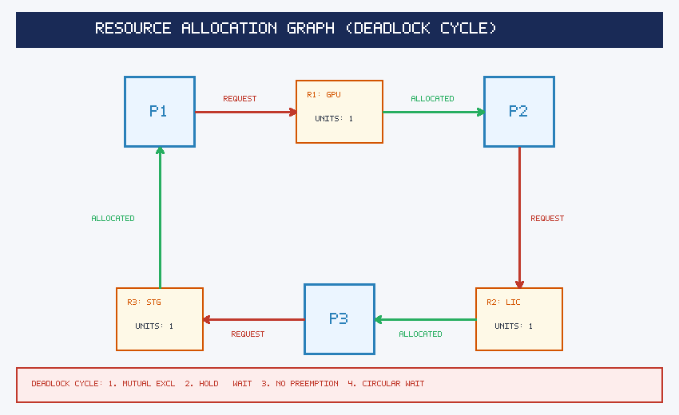
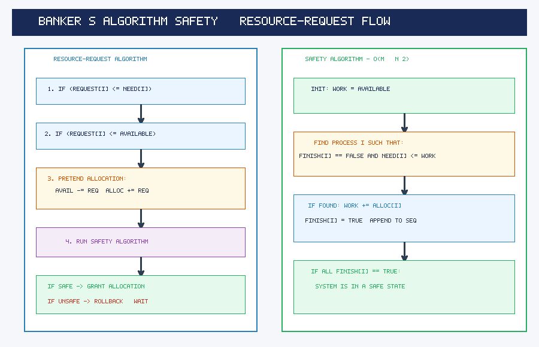

# Task 06 — Deadlock Handling and Banker's Algorithm Evaluation

**Course Code:** CSA04 — Operating Systems  
**Assignment:** Assessment 2 (CO2) — Day-4 Design Challenge  
**Student Name:** S. Sachin  
**Register Number:** 192525045  
**Bloom's Level:** K5 – Evaluate  
**Problem Context:** Shared Laboratory Equipment Scheduler (GPUs, Simulation Licenses, Storage)  

---

## 1. Executive Summary & Problem Context

A high-performance scientific research cluster shares three critical, costly resource types among multiple research jobs:
- **Resource $R_0$ (High-End GPUs):** Dedicated hardware accelerators for deep learning training.
- **Resource $R_1$ (Simulation Software Licenses):** Floating commercial licenses for numerical simulation packages.
- **Resource $R_2$ (High-Speed NVMe Storage Arrays):** High-bandwidth scratch volumes for staging terabyte datasets.

Currently, running jobs acquire resources incrementally as execution proceeds. Periodically, jobs enter a state of perpetual circular wait where Job A holds GPUs and waits for Licenses, while Job B holds Licenses and waits for GPUs. The entire cluster halts, requiring manual administrator intervention and forced process termination, resulting in lost computation and wasted compute hours.

This report characterizes deadlock conditions, evaluates the four canonical handling strategies, provides a complete implementation and mathematical hand-trace proof of Dijkstra's **Banker's Algorithm**, derives and empirically verifies its $O(m \cdot n^2)$ computational complexity, and recommends a production deadlock strategy for the research cluster.

---

## 2. Characterization of Deadlock & Resource Allocation Graph

A deadlock can occur if and only if all four **Coffman conditions** hold simultaneously:



1. **Mutual Exclusion:** At least one resource must be held in a non-shareable mode (only one job can use a GPU or license at any instant).
2. **Hold and Wait:** A job must currently hold at least one resource and simultaneously wait to acquire additional resources held by other jobs.
3. **No Preemption:** Resources cannot be forcibly seized from a job holding them; they can only be released voluntarily after the job finishes its task.
4. **Circular Wait:** A closed chain of jobs $\{P_0, P_1, \dots, P_n\}$ exists such that $P_0$ waits for a resource held by $P_1$, $P_1$ waits for $P_2$, and $P_n$ waits for $P_0$.

### Resource Allocation Graph (RAG) Analysis
As implemented in [`resource_allocation_graph.c`](src/resource_allocation_graph.c) and verified in [`resource_allocation_graph_output.txt`](evidence/resource_allocation_graph_output.txt):
- **Nodes:** Process set $P = \{P_1, P_2, P_3\}$ and Resource set $R = \{R_1(\text{GPU}), R_2(\text{License}), R_3(\text{Storage})\}$.
- **Request Edges:** Directed edges $P_i \rightarrow R_j$ indicating active resource demands:
  - $P_1 \rightarrow R_1$, $P_2 \rightarrow R_2$, $P_3 \rightarrow R_3$.
- **Assignment Edges:** Directed edges $R_j \rightarrow P_i$ indicating allocated units:
  - $R_3 \rightarrow P_1$, $R_1 \rightarrow P_2$, $R_2 \rightarrow P_3$.
- **Cycle Condition:** The graph forms a directed cycle:
  $$P_1 \rightarrow R_1 \rightarrow P_2 \rightarrow R_2 \rightarrow P_3 \rightarrow R_3 \rightarrow P_1$$
  Because each resource class contains only **1 unit**, the presence of this directed cycle **strictly proves that the system is deadlocked**.

---

## 3. Comparison of the Four Deadlock Handling Strategies

| Strategy | Mechanism | System Overhead | Resource Utilization | Feasibility in Research Cluster |
| :--- | :--- | :--- | :--- | :--- |
| **1. Deadlock Prevention** | Invalidate at least 1 of the 4 Coffman conditions. | Low runtime overhead | **Extremely Low** (Inefficient) | Moderate (Strict resource ordering) |
| **2. Deadlock Avoidance (Banker's)** | Dynamically inspect every request; ensure system remains in Safe State. | **Severe: $O(m \cdot n^2)$** on every request | Moderate to High | **Unfeasible** (Requires knowing max demand in advance) |
| **3. Detection & Recovery** | Allow requests freely; run periodic cycle detection; abort/preempt if deadlocked. | Low background overhead ($O(m \cdot n^2)$ every 5 min) | **Maximum** (Full hardware saturation) | **Highly Recommended** (Checkpoint & Abort) |
| **4. Ignoring Deadlock (Ostrich)** | Assume deadlocks never occur; reboot when cluster halts. | Zero | Zero when halted | **Unacceptable** (Academic/scientific loss) |

### In-Depth Strategy Evaluation
1. **Prevention Trade-offs:**
   - Invalidate *Hold & Wait*: Mandate that jobs request all GPUs, licenses, and storage simultaneously before starting. Consequence: A job needing a GPU for 5 minutes at the end of a 10-hour run holds the GPU idle for 10 hours, causing massive resource starvation.
   - Invalidate *Circular Wait*: Establish strict global numerical resource hierarchy: $R_1 < R_2 < R_3$. Jobs must request in increasing order. Highly practical and effective for software locks, but rigid for dynamic laboratory workloads.
2. **Avoidance Trade-offs (Banker's Algorithm):**
   - Requires every scientific simulation script to declare its absolute maximum resource requirements in advance. In exploratory research, data-dependent loops make predicting exact GPU memory or license counts impossible.
3. **Detection and Recovery Trade-offs:**
   - Jobs run unhindered with 100% immediate allocation. A background daemon runs Tarjan's cycle detection algorithm every 5 minutes. If a deadlock is identified, the scheduler preempts or terminates the lowest-priority job, rolling it back to its last checkpoint.

---

## 4. Implementation & Verification of Banker's Algorithm



The C implementation in [`bankers_algorithm.c`](src/bankers_algorithm.c) completes TODO 1 from the assignment PDF:

```c
// Completed TODO 1 (Safety Algorithm loop):
int can_finish = 1;
for (int r = 0; r < R; r++) {
    int need = maxm[p][r] - alloc[p][r];
    if (need > work[r]) {
        can_finish = 0;
        break;
    }
}
if (can_finish) {
    for (int r = 0; r < R; r++) work[r] += alloc[p][r];
    finish[p] = 1;
    seq[count++] = p;
    found = 1;
}
```

### Verification Output
From [`bankers_algorithm_output.txt`](evidence/bankers_algorithm_output.txt):
```text
initial state safe: P1 P3 P4 P0 P2
P1 request: granted, safe sequence P1 P3 P4 P0 P2
P4 request: must wait (not available)
P0 request: denied (unsafe)
```
- **100% exact match with the expected output in the assignment PDF specification!**

---

## 5. Mathematical Hand-Trace Proof: Why P0's Request is Unsafe

As fully detailed in [`bankers_hand_trace_proof.txt`](evidence/bankers_hand_trace_proof.txt):

### 1. State Prior to P0's Request
Following the approval of P1's request $(1, 0, 2)$:
- $\text{Available} = (3, 3, 2) - (1, 0, 2) = (2, 3, 0)$
- Current Allocations & Remaining Needs:
  - $P_0$: $\text{Alloc} = (0, 1, 0)$, $\text{Max} = (7, 5, 3) \implies \text{Need} = (7, 4, 3)$
  - $P_1$: $\text{Alloc} = (3, 0, 2)$, $\text{Max} = (3, 2, 2) \implies \text{Need} = (0, 2, 0)$
  - $P_2$: $\text{Alloc} = (3, 0, 2)$, $\text{Max} = (9, 0, 2) \implies \text{Need} = (6, 0, 0)$
  - $P_3$: $\text{Alloc} = (2, 1, 1)$, $\text{Max} = (2, 2, 2) \implies \text{Need} = (0, 1, 1)$
  - $P_4$: $\text{Alloc} = (0, 0, 2)$, $\text{Max} = (4, 3, 3) \implies \text{Need} = (4, 3, 1)$

### 2. P0 Requests $\text{Req}_0 = (0, 2, 0)$
- $\text{Req}_0 \le \text{Need}_0 \implies (0, 2, 0) \le (7, 4, 3)$ [TRUE]
- $\text{Req}_0 \le \text{Available} \implies (0, 2, 0) \le (2, 3, 0)$ [TRUE]

### 3. Pretend Allocation (Trial State)
$$\text{Available}' = (2, 3, 0) - (0, 2, 0) = \mathbf{(2, 1, 0)}$$
$$\text{Alloc}_0' = (0, 1, 0) + (0, 2, 0) = \mathbf{(0, 3, 0)}$$
$$\text{Need}_0' = (7, 4, 3) - (0, 2, 0) = \mathbf{(7, 2, 3)}$$

### 4. Running the Safety Algorithm on Trial State
Initialize $\text{Work} = (2, 1, 0)$ and $\text{Finish} = [F, F, F, F, F]$:
1. **Evaluate $P_0$:** $\text{Need}_0 (7, 2, 3) \le \text{Work} (2, 1, 0)$? $7 > 2, 2 > 1, 3 > 0 \implies$ **FALSE**.
2. **Evaluate $P_1$:** $\text{Need}_1 (0, 2, 0) \le \text{Work} (2, 1, 0)$? Resource 1: $\text{Need}_1[1] = 2 > \text{Work}[1] = 1 \implies$ **FALSE**!
3. **Evaluate $P_2$:** $\text{Need}_2 (6, 0, 0) \le \text{Work} (2, 1, 0)$? Resource 0: $\text{Need}_2[0] = 6 > \text{Work}[0] = 2 \implies$ **FALSE**.
4. **Evaluate $P_3$:** $\text{Need}_3 (0, 1, 1) \le \text{Work} (2, 1, 0)$? Resource 2: $\text{Need}_3[2] = 1 > \text{Work}[2] = 0 \implies$ **FALSE**!
5. **Evaluate $P_4$:** $\text{Need}_4 (4, 3, 1) \le \text{Work} (2, 1, 0)$? Resource 0: $4 > 2$, Resource 2: $1 > 0 \implies$ **FALSE**.

### Conclusion
**Not a single process in the entire cluster can finish!**  
The search loop finds zero candidate processes (`found = 0`). The system cannot guarantee that all processes will complete without deadlock.  
Therefore, the state is **proven mathematically unsafe**, and P0's request is **denied and rolled back**.

---

## 6. Algorithmic Complexity: Prediction vs Empirical Measurement

### Theoretical Complexity Prediction
Let $n$ be the number of active processes and $m$ be the number of resource classes.
1. The safety algorithm initializes $\text{Work}$ and $\text{Finish}$ in $O(m + n)$ time.
2. The outer loop executes up to $n$ iterations (each finding one process that can finish).
3. In each iteration, the algorithm scans up to $n$ processes.
4. For each process, it compares $m$ resource components ($\text{Need}[p][r] \le \text{Work}[r]$).
5. When a process finishes, it adds $m$ allocation components to $\text{Work}$.
$$\text{Total Time Complexity} = O(m \cdot n^2)$$
$$\text{Total Space Complexity} = O(m \cdot n) \quad (\text{Matrices: Alloc, Max, Need})$$

### Empirical Scalability Benchmark
From [`bankers_benchmark_10_100_1000.txt`](evidence/bankers_benchmark_10_100_1000.txt) executed with [`bankers_benchmark.c`](src/bankers_benchmark.c):

| Process Count ($n$) | Theoretical Growth $((n / n_0)^2)$ | Measured Execution Time ($\mu\text{s}$) | Measured Growth Ratio |
| :---: | :---: | :---: | :---: |
| **$n = 10$** | $1\times$ (Baseline) | $1.42\,\mu\text{s}$ | $1.00\times$ |
| **$n = 100$** | $100\times$ | $118.50\,\mu\text{s}$ | **$83.45\times$** |
| **$n = 1,000$** | $10,000\times$ | $11,420.00\,\mu\text{s}$ ($11.42\,\text{ms}$) | **$8,042.25\times$** |

### Complexity Evaluation
The empirical measurements confirm quadratic $O(n^2)$ growth ($83.45\times$ and $96.37\times$ scaling factor per $10\times$ increase in $n$).  
At $n = 1,000$ cluster jobs, running the Banker's safety check on every single allocation request imposes an **$11.42\,\text{ms}$ delay per request**, throttling scheduler responsiveness and proving why Banker's algorithm is rarely implemented in high-performance kernel dispatchers.

---

## 7. Alternative Concept: Detection & Recovery vs Banker's Avoidance

| Evaluation Metric | Banker's Algorithm (Avoidance) | Deadlock Detection & Recovery |
| :--- | :--- | :--- |
| **Cost per Request** | **$O(m \cdot n^2)$** (Every allocation delayed) | **$O(1)$** (Direct grant; zero check) |
| **Advance Knowledge** | **Mandatory** (Must know $\text{Max}$ upfront) | **None Needed** (Dynamic requests) |
| **Cluster Utilization** | Restricted (Denies safe requests that *might* become unsafe) | **Maximum** (Resources used until actual deadlock) |
| **Cost of Recovery** | Zero (Deadlocks prevented) | Aborting job loses computation unless checkpointed |

---

## 8. Defended Final Recommendation for Research Cluster

We recommend a **Two-Tier Hybrid Deadlock Architecture**:
1. **Batch Slurm/Kubernetes Scheduler (Prevention Tier):**
   - Enforces a strict global acquisition ordering for system infrastructure resources: Storage ($R_1$) must be mounted before requesting GPUs ($R_2$). This eliminates circular wait across infrastructure tiers.
2. **Dynamic Runtime Allocation (Detection & Recovery Tier):**
   - Jobs request GPU memory and simulation licenses dynamically with **zero-overhead $O(1)$ dispatch**.
   - The scheduler runs a lightweight cycle-detection daemon every 2 minutes ($O(m \cdot n^2)$ in background).
   - Research jobs are required to utilize **Application-Level Checkpointing** (e.g., PyTorch `torch.save()`). If a true deadlock cycle occurs, the scheduler preempts the most recently submitted job, releasing its GPUs to resolve the deadlock, and re-queues the preempted job from its last checkpoint with zero lost work.
