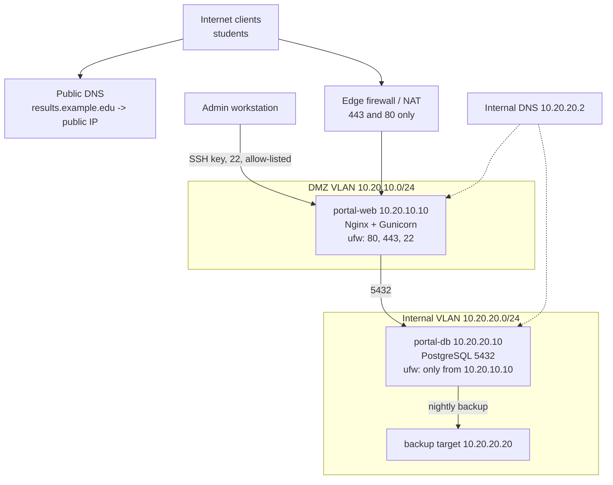

# Diagram D7 – Network Topology (supports A2.2)

Addresses are **design assumptions** using the private range 10.20.0.0/16 and the documentation domain `example.edu`; replace with the university's real values.

